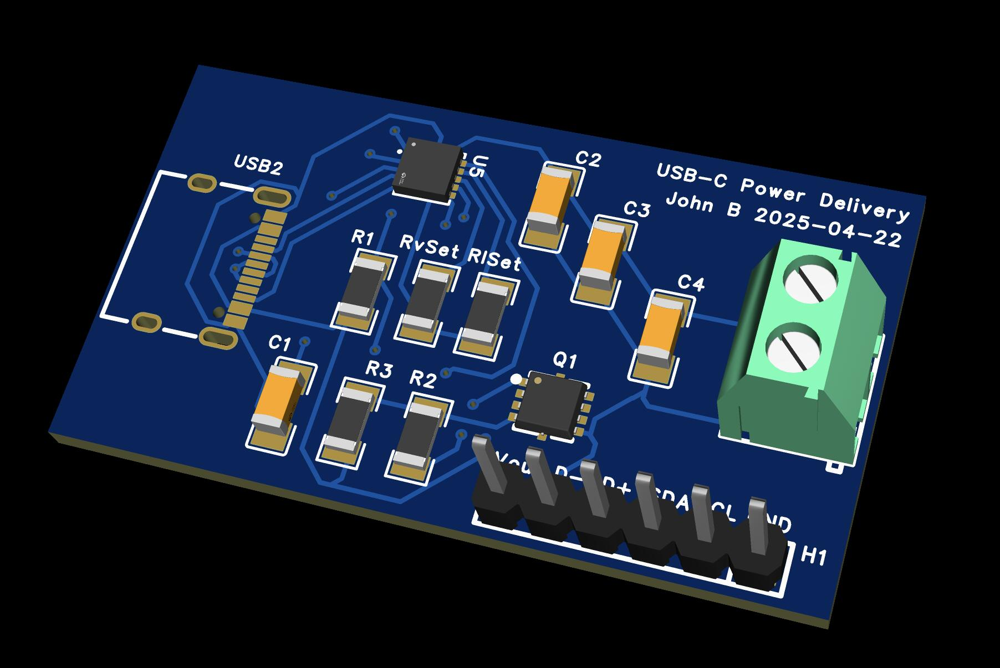
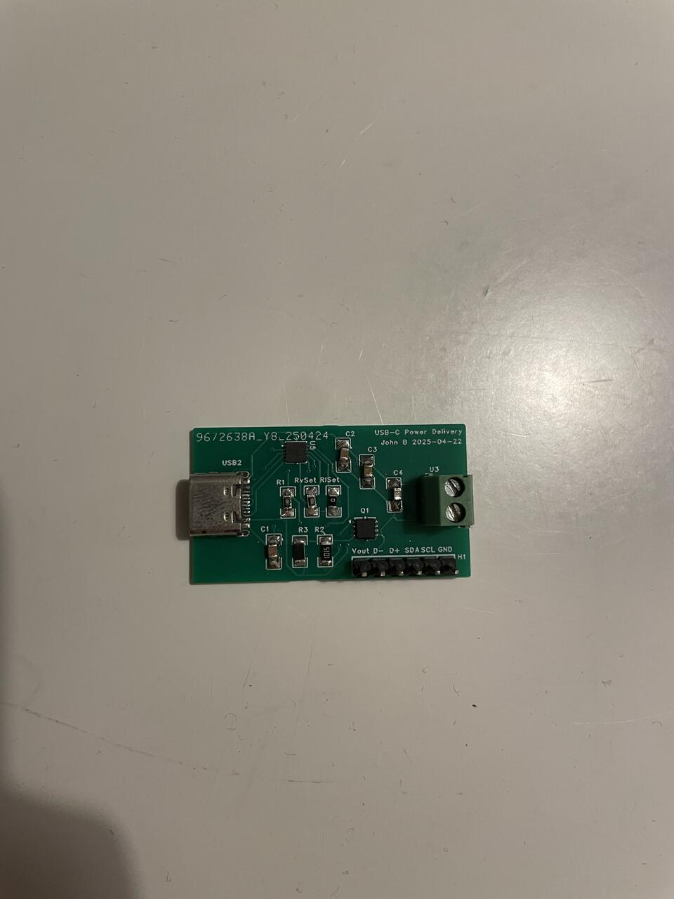
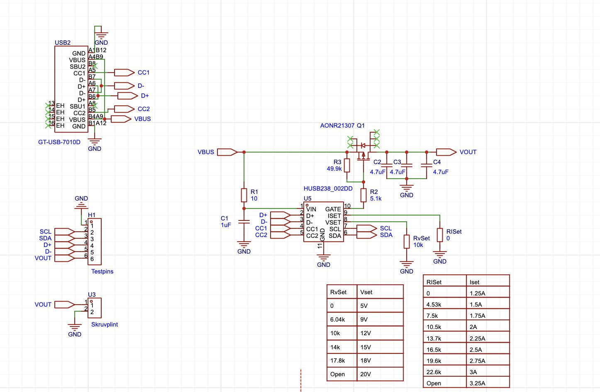

# USB-C Power Delivery Sink Module (HUSB238 — Up to 100W)

A compact, 2-layer **USB-C Power Delivery (PD) sink breakout and power module** built around the **Hynetek HUSB238** USB PD controller IC. Designed in **EasyEDA Pro**, the board negotiates fixed PD profiles up to **20V / 5A (100W)** over USB-C (`CC1`/`CC2`) and provides both high-current output terminals and an exposed I2C / USB 2.0 interface header for host microcontroller integration.

  
  

---

## Hardware Specifications & Board Parameters

| Parameter | Specification |
| :--- | :--- |
| **PD Controller IC** | Hynetek HUSB238 (10-pin DFN/QFN package, `U5`) |
| **Input Connector** | USB Type-C Receptacle (`USB2`, USB 2.0 + CC1/CC2) |
| **Output Power Rating** | Up to 100W (5V, 9V, 12V, 15V, 18V, 20V @ up to 5A) |
| **Configuration Modes** | Hardware resistor-selectable (`RvSet`, `RISet`) or dynamic I2C control (`SDA`, `SCL`) |
| **Power Switching** | High-current N-Channel/P-Channel load switch MOSFET (`Q1`) gating `VBUS` to `VOUT` |
| **Output Interfaces** | 2-pin high-current terminal (`U3`: `VOUT`, `GND`) + 6-pin 2.54 mm header (`H1`) |
| **Board Dimensions** | 41.0 mm x 23.0 mm (2-Layer FR-4) |
| **EDA Tool** | EasyEDA Pro v2.2.37 |

---

## Circuit Architecture & Design Highlights

1. **Dual Configuration Modes (Hardware Resistors & I2C):**
   - **Standalone Mode:** Dedicated resistor footprints (`RvSet` on pin 8 and `RISet` on pin 9) allow fixed hardware selection of target voltage and current PDOs without requiring an external microcontroller.
   - **Dynamic I2C Control:** Exposes `SDA` and `SCL` on header `H1` so a host MCU (such as an STM32 or ESP32) can dynamically query available source capabilities and switch PD voltage profiles at runtime.
2. **Load Switch Protection (`Q1`):**
   - `VBUS` from the USB-C receptacle is isolated from `VOUT` via power MOSFET `Q1`, controlled by the HUSB238 gate drive output (`pin 10`), ensuring `VOUT` is only energized once a valid PD contract is established.
3. **Decoupling & Filtering:**
   - Input decoupling (`C1` on `VDD`) and parallel output bulk/ceramic decoupling (`C2`, `C3`, `C4` across `VOUT` and `GND`) minimize voltage ripple during load transients.

---

## Pinout & Interface Header (`H1` & `U3`)

### High-Current Output Terminal (`U3`)
| Pin | Signal | Description |
| :--- | :--- | :--- |
| **1** | `VOUT` | Negotiated DC output voltage (5V – 20V, up to 5A) |
| **2** | `GND` | Common ground reference |

### Control & Data Breakout Header (`H1` — 2.54 mm Pitch)
| Pin | Signal | Description |
| :--- | :--- | :--- |
| **1** | `GND` | Common ground reference |
| **2** | `SCL` | I2C clock line to HUSB238 |
| **3** | `SDA` | I2C data line to HUSB238 |
| **4** | `D+` | USB 2.0 differential data positive passthrough |
| **5** | `D-` | USB 2.0 differential data negative passthrough |
| **6** | `VOUT` | Negotiated DC output rail |

---

## Bill of Materials (BOM) Overview

Extracted from the production layout (`FlyingProbeTesting.json`):

| Designator | Function / Component | Layer |
| :--- | :--- | :--- |
| `U5` | Hynetek HUSB238 USB-C PD Sink Controller | Top |
| `Q1` | Power Load Switch MOSFET (8-pin) | Top |
| `USB2` | USB Type-C Receptacle | Top |
| `U3` | 2-Pin High-Current Output Terminal (`VOUT` / `GND`) | Top |
| `H1` | 6-Pin 2.54 mm Breakout Header (`GND`, `SCL`, `SDA`, `D+`, `D-`, `VOUT`) | Top (THT) |
| `RvSet` | Target Voltage Selection Resistor | Top |
| `RISet` | Target Current Limit Selection Resistor | Top |
| `R1`, `R2`, `R3` | Gate Drive / Pull-up / Bias Resistors | Top |
| `C1` | HUSB238 `VDD` Supply Decoupling Capacitor | Top |
| `C2`, `C3`, `C4` | `VOUT` Output Decoupling Capacitors | Top |

---

## Manufacturing & Gerber Files

Complete fabrication files are included in `production/USBC_PD.zip` and verified for standard 2-layer PCB fabrication (e.g., JLCPCB / PCBWay):

- **Copper Layers:** `Gerber_TopLayer.GTL`, `Gerber_BottomLayer.GBL`
- **Solder Mask & Paste:** `Gerber_TopSolderMaskLayer.GTS`, `Gerber_BottomSolderMaskLayer.GBS`, `Gerber_TopPasteMaskLayer.GTP`
- **Silkscreen & Outline:** `Gerber_TopSilkscreenLayer.GTO`, `Gerber_BottomSilkscreenLayer.GBO`, `Gerber_BoardOutlineLayer.GKO`
- **Excellon Drill Files:** `Drill_PTH_Through.DRL`, `Drill_NPTH_Through.DRL`, `Drill_PTH_Through_Via.DRL`

